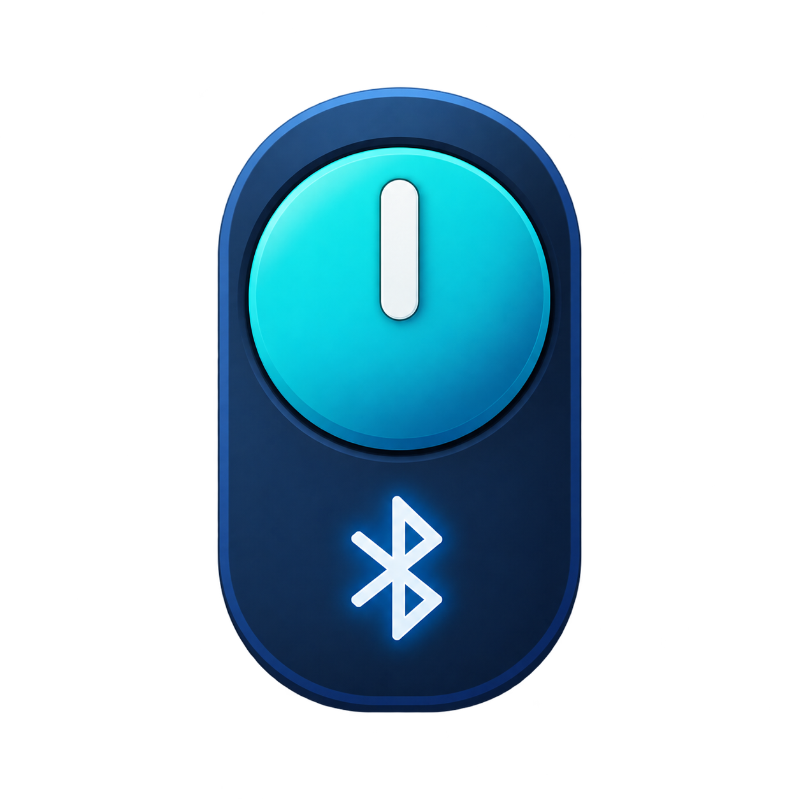
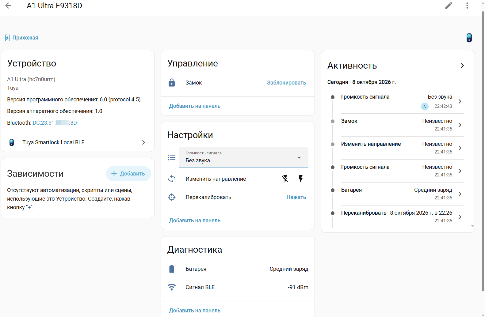

# Tuya Smartlock Local BLE

[English](README.md) · [Установка](INSTALL.ru.md) · [Архитектура](ARCHITECTURE.md)

Локальное управление **A1 Ultra / A1 Ultra-JM** через Bluetooth. Поддерживается Tuya product **hc7n0urm**, категория **jtmspro**, сервис FD50. Похожее название другого замка не означает совместимость.

- Закрытие и открытие из Home Assistant без BLE-подключения телефона.
- Постоянное соединение по умолчанию, запросы состояния и восстановление с задержкой после сбоев.
- Уровень батареи и дополнительный датчик Bluetooth-сигнала (RSSI).
- Настройка через интерфейс HA без ручной правки YAML/JSON.
- Отдельные классы моделей, протоколов и команд для расширения поддержки.

**Сначала нужно получить данные своего замка.** Обнаружение по Bluetooth не извлекает ключи. Наличие интеграции Tuya не означает их автоматический импорт. Порядок описан в [INSTALL.ru.md](INSTALL.ru.md).

## Управление и диагностика

| Возможность | Что делает |
| --- | --- |
| Управление замком | Обычный элемент управления HA и сервисы замка, включая `lock.toggle`. Его состояние отражает выбранное действие. |
| Открыть / Закрыть | Раздельные кнопки команд; доступны при загруженной интеграции, в том числе при разрыве BLE. Заменяют прежнюю кнопку «Переключить». |
| Статус | При необходимости подключается и запрашивает отчёты устройства без движения мотора. |
| Статус замка | Показывает последнее полученное от устройства положение отдельно от выбранного действия. |
| Ожидаемое действие | Открывается, Закрывается или Завершено по отчёту; это выбранное действие, а не измеренное движение мотора. |
| Перекалибровка | По нажатию кнопки отправляет команду калибровки этой модели; она может двигать мотор и изменять настройки его хода. |
| Направление вращения | Переключает направление мотора под ориентацию установки. |
| Громкость сигнала | Выбор **Без звука** или **Нормальный**; другие уровни для этой модели не реализованы. |
| Батарея | Показывает переданную замком категорию: высокий, средний, низкий заряд или разряжена; без выдуманного процента. |
| Сигнал BLE | Дополнительный RSSI-датчик в dBm, по умолчанию отключён. В отключённых объектах устройства активируйте **Сигнал BLE**. Он показывает последний принятый BLE-анонс, а не непрерывное измерение активного соединения. |
| Сведения об устройстве | Версии прошивки, протокола BLE и аппаратного обеспечения. |
| Постоянное соединение | Периодически запрашивает состояние и повторяет подключение после сбоев; непрерывность радиосвязи не гарантируется. |

Настройки могут показывать **Неизвестно**, пока замок не передаст их или не подтвердит изменение. Калибровка никогда не запускается автоматически при добавлении, восстановлении связи и опросе состояния. Установка прошивки (OTA) пока не реализована.

## Страница устройства в Home Assistant

Страница устройства в одной из предыдущих версий. В версии 0.5.0 добавлены раздельные кнопки «Открыть», «Закрыть», «Статус» и датчик ожидаемого действия.

В **Настроить** сначала выбирается **Постоянное соединение** (по умолчанию включено), затем показываются настройки выбранного режима. Уже настроенная интеграция загружает управление, даже если замок вне зоны связи. Доступность кнопки означает возможность принять запрос, а не наличие Bluetooth-соединения или гарантию выполнения.

При **постоянном соединении** интеграция поддерживает сеанс, запрашивает статус каждые 30 секунд и переподключается после короткой паузы, увеличивая задержку при сбоях. Можно включить **Ожидать переподключения перед командой (до 10 секунд)**, по умолчанию выключено. Тогда команда открытия/закрытия ждёт начала отправки через защищённый сеанс не более 10 секунд с момента вызова; просроченная команда отбрасывается. Без этой настройки команда при отсутствии соединения сразу завершается ошибкой. Кнопка «Статус» может сама запросить подключение в любом режиме.

При **непостоянном соединении** доступны интервал опроса: выключен либо 10, 20, 30, 40, 50, 60 секунд (по умолчанию 20), и удержание соединения после команды с теми же вариантами (по умолчанию 10). Сеанс только для опроса запрашивает статус, ждёт корректного пассивного отчёта и отключается. Если одновременно выполняется действие или ещё действует его удержание, опрос не разрывает соединение. Плановые опросы пропускаются во время действия и удержания. Удержание отсчитывается после завершения обработки команды, а не подтверждённого окончания движения. При выключенном удержании свободное соединение закрывается сразу; поздний отчёт о положении может прийти лишь при следующем опросе или нажатии «Статус».

В непостоянном режиме каждое действие делает собственную ограниченную по времени попытку подключения. Неудавшийся запрос не сохраняется до следующего опроса или переподключения. Новая команда открытия/закрытия заменяет локальное ожидание предыдущей; начатая запись пакета завершается до отправки следующей. Потеря подтверждения не вызывает автоматического повтора моторной команды в любом режиме. Выгрузка и перезапуск отменяют незавершённую работу; она не сохраняется. Атрибуты `bluetooth_connected` и `command_pending` показывают связь и выполнение.

В текущих аппаратных испытаниях сохранялись короткие разрывы примерно раз в две минуты с автоматическим восстановлением. Причина этого цикла ещё исследуется; режим постоянного соединения пока не обеспечивает полностью непрерывную доступность.

## Установка

Нужны Home Assistant **2026.10.0 или новее**, настроенный Bluetooth с поддержкой подключений, включённый замок в радиусе приёма и HACS. На оборудовании проверялся локальный адаптер BlueZ; работа через прокси отдельно не проверялась.

Добавьте `https://github.com/asemenov566/tuya_smartlock_local_ble` в HACS как пользовательский репозиторий типа **Интеграция**. В стандартный каталог HACS проект не включён. Следуйте [инструкции от установки до первого соединения](INSTALL.ru.md).

## Границы проверки

Открытие, закрытие, BLE-связь и датчик сигнала проверялись на реальном оборудовании в ходе разработки. Громкость, направление и калибровка реализованы по установленной схеме команд модели и покрыты автоматическими тестами; полная аппаратная проверка каждой настройки ещё предстоит.

Команда и её подтверждение не доказывают положение или движение механизма. Мгновенный физический разворот по обратной команде во время движения остаётся нерешённым и не заявляется как проверенная возможность. Распознавание заклинивания не реализовано; отчёт контроллера сам по себе не гарантирует правильного физического конечного положения. Батарея представлена категориями, без выдуманного процента. Камера и функции только для облака не реализованы. Постоянная связь может увеличить расход батареи; суточная стабильность и срок работы батареи не измерялись.

## Работа без облака

После первоначальной настройки компонент общается с замком по BLE и не обращается к Tuya Cloud. SmartLife/Tuya нужны для привязки и получения ключей. После сброса или перепривязки данные могут измениться. Удалять замок из SmartLife для отказа от облака не нужно: последствия такой отвязки для ключей не проверены.

Domain HA и каталог компонента — **`tuya_smartlock_local_ble`**, как имя репозитория. Другие интеграции Tuya можно установить рядом, но активно подключаться к конкретному замку должна только одна BLE-интеграция.

## Разработка

[Архитектура](ARCHITECTURE.md), [скилл добавления моделей](.skills/add-lock/SKILL.md). Тесты используют искусственные данные и имитацию устройств. Не прикладывайте ключи, файлы HA `.storage` и необработанную диагностику к issues/PR.

Запускайте тесты через `python scripts/run_tests.py protocol`, `ha` или `packaging`: они используют временный профиль. Команда `python scripts/build_release.py` собирает установочный ZIP по явному списку файлов без локальных ключей, профилей, отчётов и скриншотов документации. Подробнее — в [инструкции по проверкам и сборке](ARCHITECTURE.md#validation).

Лицензия [MIT](LICENSE).

MIT разрешает использовать, изменять и распространять код, в том числе коммерчески, при сохранении уведомлений об авторских правах и разрешении. В LICENSE сохранено исходное уведомление и добавлено авторство наших изменений за 2026 год.

## Управление и статус замка

«Управление замком» меняет выбранное действие сразу после нажатия: можно сразу выбрать обратное. Сервис `lock.toggle` инвертирует это же действие. Отчёты положения также синхронизируют управление; повторный отчёт об исходном положении не отменяет ожидаемое действие. Если направление ещё неизвестно, используйте явное «Открыть» или «Закрыть». Отправка обратной команды не гарантирует немедленного физического разворота.

Отдельный датчик «Статус замка» показывает только полученный от устройства DP47: закрыт / открыт. Новая команда сбрасывает значение до свежего отчёта; ACK и обновления батареи/громкости не подтверждают положение. При постоянном соединении разрыв также сбрасывает значение. В непостоянном режиме после отключения сохраняется последний отчёт с атрибутами `cached: true`, `reported_at` (локальное время получения) и `bluetooth_connected: false`. Кэш действует только до выгрузки интеграции и не является текущим измерением отключённого замка.

«Ожидаемое действие» имеет `state_source: requested_action`. «Открывается» и «Закрывается» описывают выбранный запрос, включая ожидание подключения; «Завершено по отчёту» означает совпадение отчёта положения с запросом. Это не датчик движения или заклинивания. Настройку направления выполняет прошивка замка: она не меняет местами логические команды открытия/закрытия и трактовку DP47 в HA. Кнопка «Статус» запрашивает снимок состояния, но обновляются только фактически присланные устройством значения.

Для текущего положения и настроек используются обычные отчёты устройства. Пакеты событий с временными метками подтверждаются, но не меняют текущие значения: трактовка истории и часов замка пока не проверена. Один такой пакет не завершает запрос статуса и не подтверждает новое положение.

При обновлении прежняя отдельная кнопка «Переключить» удаляется. В автоматизациях, которые на неё ссылались, выберите новые «Открыть»/«Закрыть» либо сервисы существующей сущности замка. Обычное управление HA сохраняется. Калибровка остаётся отдельной явной командой и не запускается при запросе статуса.
